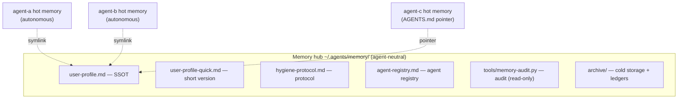

# agent-memory-hub

**Memory governance for multi-agent setups: one protocol, one audit tool, six templates.**

English | [简体中文](README.md)

---

## The Problem

When you run two or more AI agents at the same time (coding assistants, IDE-embedded agents, CLI agents), four failure modes show up:

| Failure mode | Symptom |
|---|---|
| **Memory fragmentation** | agent-a knows something agent-b doesn't; the same "user preference" reads differently in each agent |
| **Memory rot** | The profile still holds stale state from three months ago (a job, a city, a project that has since changed) — and nobody notices |
| **Context dilution** | One agent's hot memory balloons to 20KB, gets fully injected at every session start, and stale content skews its judgment |
| **Governance stall** | Either nobody maintains the system, or every change queues behind a single human approval and maintenance tasks pile up |

The answer of this framework: **shared content lives in an agent-neutral hub (SSOT + symlink onboarding), each agent owns its own hot memory, and a three-role rotation keeps the system healthy.**

## Core Concepts (5)

1. **SSOT (Single Source of Truth)** — the shared profile has exactly one authoritative copy; every other location holds a symlink or a derived short version. A second "source of truth" is forbidden.
2. **Hot / warm / cold tiering** — memory is split by read frequency: hot (≤ 8KB, injected every session) / warm (daily journals, untouched after 7 days) / cold (archived, retrieval-only). The point of tiering is to control the attention budget of every session.
3. **Expression hygiene: fact / rule / fossil / log** — the core test: *when this memory is read aloud, must the wrong value appear for the sentence to make sense?* Memory written for LLM injection follows the opposite logic of documents written for humans: documents want changes to be visible, memories want wrong values to be invisible.
4. **Sentinel / Doctor / Tracker** — daily audit (exception-driven, a heartbeat even when all green) / weekly review (metrics, trends, protocol evolution) / per-project closure loop (guards against plan theater and output theater).
5. **Tiered change approval** — 🟢 low-risk changes take effect by default and can be vetoed afterwards / 🟡 medium-risk items auto-re-escalate after 7 days / 🔴 high-risk changes always require human confirmation. The governance mechanism itself must not become the bottleneck.

## Architecture



**Boundary rule**: no agent ever writes into another agent's hot memory; the hub only owns the SSOT, the protocol, the registries, the archive, and the audit tool.

## Quick Start (5 minutes)

```bash
git clone <repo-url> && cd agent-memory-hub

# 1. Initialize the hub (copy the example hub as your hub directory)
cp -r examples/minimal-hub/hub ~/.agents/memory
#    Replace the fake data in hub/user-profile.md with your real profile

# 2. Onboard an agent (symlink template; adjust to your agent list)
ln -s ~/.agents/memory/user-profile.md ~/.your-agent/user-profile.md

# 3. Run the first audit (the Sentinel's daily job)
python3 tools/memory-audit.py --hub ~/.agents/memory \
    --link "your-agent=~/.your-agent/user-profile.md" \
    --hot  "your-agent-MEMORY=~/.your-agent/MEMORY.md"
# Expected: all 🟢, exit code 0 (0=clean, 1=warnings, 2=critical)

# 4. Schedule the rotation: run the audit daily + append a heartbeat (even when all green); run the weekly review every week
```

A fully runnable demo lives in [`examples/minimal-hub/`](examples/minimal-hub/) (fake data + ready-made symlinks; runs out of the box after clone).

## Directory Layout

| Path | Contents |
|---|---|
| `docs/hygiene-protocol.md` | **The protocol**: tiering, write rules, expression hygiene, correction protocol, three roles, tiered approval |
| `docs/architecture.md` | Architecture in practice: directory layout, two onboarding methods, six agent roles, failure-mode cheatsheet |
| `tools/memory-audit.py` | Audit tool (read-only, writes nothing): five checks — SSOT / symlinks / quick version / size / fossils |
| `templates/` | Six templates: agent registry, heartbeat ledger, metrics ledger, weekly review, archive index, revision log |
| `examples/minimal-hub/` | Minimal runnable example |

## Roadmap

- [ ] GitHub Action template (Sentinel as CI, heartbeat written back to the repo)
- [ ] Multiple profiles (a hub variant separating project profiles from user profiles)
- [ ] Configurable fossil-scan rules (externalized regex list)
- [ ] English docs for the protocol and architecture

## License

MIT
