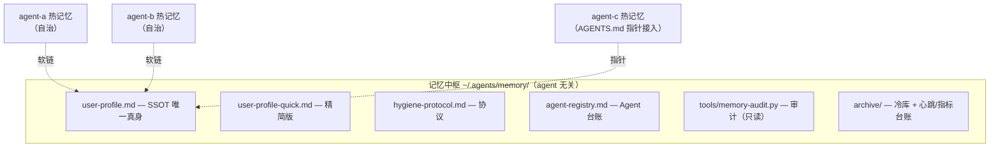

# agent-memory-hub

**多 Agent 记忆治理框架：一套让多个 AI Agent 共享同一份记忆、且互不污染的协议 + 工具 + 模板。**

*Memory governance for multi-agent setups: one protocol, one audit tool, six templates.*

---

## 解决什么问题

当你同时用两个以上的 AI Agent（编程助手、IDE 内置 agent、命令行 agent），记忆问题会以四种方式出现：

| 病症 | 现象 |
|---|---|
| **记忆碎片化** | agent-a 知道的事，agent-b 不知道；同一份"用户偏好"在各 agent 嘴里不一样 |
| **记忆腐烂** | 画像里残留三个月前的过期状态（如职务、城市、项目状态已变而画像未更新），且没人发现 |
| **上下文稀释** | 某 agent 的热记忆涨到 20KB，每次会话全量注入，过期内容带偏判断 |
| **治理停摆** | 要么没人管，要么所有变更都堆着等一个人审批，治理任务一拖再拖 |

本框架的答案：**共享内容收编到 agent 无关的中枢目录（SSOT + 软链接入），各 agent 自己的热记忆各自自治，一套三角色周期机制保持系统健康。**

## 核心概念（5 个）

1. **SSOT 唯一真身**——共享画像只存在一个权威副本，其他位置只允许软链或派生精简版，禁止第二份真身
2. **热/温/冷分层**——按读取频率分三层：热（≤8KB 常驻注入）/ 温（日记，超 7 天不读）/ 冷（归档，检索式）；分层的本质是控制每次会话的注意力预算
3. **表述卫生四分法**——事实 / 规则 / 化石 / 日志；核心判据：*这条记忆被朗读时，错误值必须出现才能表达意思吗？* 面向 LLM 注入的记忆，写法逻辑和面向人的文档相反——文档追求"改动可见"，记忆追求"错误值不可见"
4. **哨兵 / 医生 / 追踪器**——日频审计（异常驱动，全绿也留心跳）/ 周检（指标趋势与进化）/ 项目周期闭环（防计划空转与产出空转）
5. **变更分级审批**——🟢 低风险默认生效可否决 / 🟡 中风险 7 天自动重提 / 🔴 高风险人工确认；治理机制自己不能成为瓶颈

## 架构



**边界铁律**：任何 agent 不越权写其他 agent 的热记忆；中枢只拥有 SSOT、协议、台账、归档、审计脚本。

## 快速开始（5 分钟）

```bash
git clone <repo-url> && cd agent-memory-hub

# 1. 初始化中枢（把示例 hub 复制为你的中枢目录）
cp -r examples/minimal-hub/hub ~/.agents/memory
#    把 hub/user-profile.md 的假数据换成你的真画像

# 2. 接入 agent（软链接入范本，按你的 agent 清单增删）
ln -s ~/.agents/memory/user-profile.md ~/.你的agent/user-profile.md

# 3. 跑第一次审计（哨兵动作）
python3 tools/memory-audit.py --hub ~/.agents/memory \
    --link "你的agent=~/.你的agent/user-profile.md" \
    --hot  "你的agent-MEMORY=~/.你的agent/MEMORY.md"
# 预期：全部 🟢，退出码 0（0=全绿 1=告警 2=严重）

# 4. 挂周期任务：每日跑审计 + 写心跳（全绿也留痕）；每周跑一次周检
```

完整可运行演示见 [`examples/minimal-hub/`](examples/minimal-hub/)（假数据 + 现成软链，clone 即可跑）。

## 目录说明

| 路径 | 内容 |
|---|---|
| `docs/hygiene-protocol.md` | **协议本体**：分层、写入规范、表述卫生、修正协议、三角色、变更分级 |
| `docs/architecture.md` | 架构落地：目录结构、两种接入方式、六类 agent 角色、故障模式速查 |
| `tools/memory-audit.py` | 审计脚本（只读，不写任何文件）：SSOT/软链/quick/体积/化石五项检查 |
| `templates/` | 6 件模板：agent 台账、心跳台账、指标台账、周检报告、归档索引、修订档案 |
| `examples/minimal-hub/` | 最小可运行示例 |

## 路线图

- [ ] GitHub Action 模板（哨兵 CI 化，心跳写回仓库）
- [ ] 多画像支持（项目画像与用户画像分离的中枢变体）
- [ ] 化石扫描规则的可配置化（正则清单外置）
- [ ] 英文版协议文档

## License

MIT
