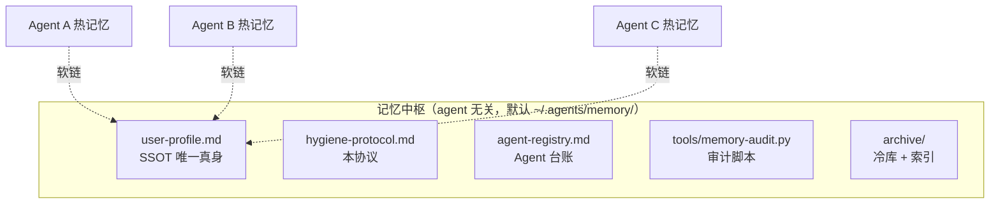

# 记忆卫生协议（Memory Hygiene Protocol）

> **协议版本**：v3.3
> **定位**：本协议是 agent-memory-hub 的核心规则文件，定义多 Agent 环境下记忆的**分层、写入、表述、修正、周期治理与变更审批**六大机制。
> **适用对象**：同时使用两个及以上 AI Agent（编程助手、命令行 agent、IDE 内置 agent 等）且希望它们共享同一份"用户/项目画像"而不互相污染的人。
> **阅读顺序建议**：先读本文档建立规则全景 → 再读 `architecture.md` 理解目录与接入方式。

---

## 〇、一句话架构

所有 Agent 的记忆分两类管：**各 Agent 自己的热记忆各自自治**（自己写自己的，中枢不越权），**跨 Agent 共享内容（画像、协议、台账、归档）由中枢统一管**（唯一真身 + 软链接入）。

> **SSOT**（Single Source of Truth，唯一真身）：同一份内容只允许存在一个权威副本，其他位置只允许软链或派生副本（如精简版），禁止出现第二份"真身"。

---

## 一、分层模型（热 / 温 / 冷）

按"被读取的频率"把记忆分三层，每层有明确载体和体积红线。**分层的目的是控制每次会话启动时注入上下文的成本**——注入越多，注意力越稀释，过期内容还更容易带偏判断。

| 层 | 载体 | 红线 | 说明 |
|---|---|---|---|
| 🔥 热 | 各 Agent 自己的 MEMORY.md（常驻注入） | ≤ 8KB | 只放状态卡 + 指针 + 近期要点；**细节禁止内嵌**，大块内容指向具体文件路径 |
| 🌤️ 温 | 工作区日记（按日追加）+ 进行中项目文档 | 超 7 天不主动读 | 每周提炼一次，提炼后沉冷库 |
| 🧊 冷 | 中枢 `archive/`（全文归档，检索式） | 平时零注入 | 归档必须在 `archive/README-归档索引.md` 登记一行，否则视为未归档 |

**新鲜度衰减规则**：

1. 易变事实（职务、项目状态、版本号等）90 天到期，以 SSOT 当前表述为准，删除过期副本
2. 项目细节在项目结束 30 天后迁冷库
3. 稳定事实（长期偏好、铁律）长期保留，每季度复核一次

> 阈值（8KB / 7 天 / 90 天）为默认值，应按各 Agent 实际上下文窗口调整；调整属于 🟡 中风险变更，见第六节。

---

## 二、写入规范（所有 Agent 必须遵守）

1. **先落日记，后进热记忆**：新知识先写 daily 日志（raw 原文），压缩沉淀后才允许进 MEMORY.md；禁止把整段原始内容复制进热记忆
2. **易变事实必带来源和日期**：格式 `[Source: YYYY-MM-DD]`；过期状态直接覆盖，不累积历史副本
3. **热记忆只放指针**：MEMORY.md 里出现大块细节 = 违规，应改写为"详见 `路径`"
4. **可删可压缩，需追溯的进冷库**：删之前问一句"这条以后要不要查"——要查就归档，不要查就删
5. **发现错误走修正协议**（见第四节），禁止静默修改
6. **热记忆超 8KB 触发瘦身手术**：由审计脚本自动发现，周检执行

---

## 三、表述卫生（四分法）

**这是整套协议里最核心的一条**。记忆是会被反复朗读注入的文本，一条记忆的"表述方式"直接决定它被读到时产生正面作用还是负面作用。

### 四分法定义

| 类型 | 定义 | 处置 |
|---|---|---|
| **事实** | 正面正确的当前值（"当前部署环境是生产集群"） | 保留 |
| **规则** | 约束未来行为的约定（"删除文件前先列方案确认"） | 保留 |
| **化石** | 为禁错误值而**复述错误值**、或叙述纠错过程（"原记项目在 A 阶段，有误"） | **改写为正面事实**；过程史降级为带日期日志 |
| **日志** | 带日期的历史段（"2026-09-24 完成中枢移交"） | 允许保留 |

### 核心判据

> **这条记忆被朗读时，错误值必须出现才能表达意思吗？**
> 不必出现 → 它是化石，改写。

例：`原记画像在 ~/旧工具目录/，已迁移至 <hub>` 是化石（错误路径被复述）。
改写为：`记忆中枢：~/.agents/memory/`（正面事实），迁移过程进日记或归档。

### 执行细则

- **禁止新增删除线补丁**（`~~旧值~~`）：删除线是最典型的化石格式，旧值每次被朗读都被强化一次
- `[修正: YYYY-MM-DD]` 标签是唯一跳过信号：确需保留修正痕迹时用这个标签，审计脚本对带此标签的行跳过化石扫描
- 化石扫描由 `tools/memory-audit.py` 自动执行（正则见脚本 `FOSSIL_PATTERNS`），命中即 🟡 告警

---

## 四、修正协议（发现错误时）

按顺序执行，禁止跳步：

1. **找证据**：先独立验证错误确实存在（读文件/跑命令/问用户），不凭印象改
2. **原位置正面改写**：在错误所在位置直接写正确值，并打 `[修正: YYYY-MM-DD]` 标签
3. **全局 grep 残留**：同一错误值可能在其他文件有副本，全库搜一遍
4. **记入修订档案**：在中枢 `memory-revisions.md` 追加一行（日期 + 内容 + 涉及文件 + 证据来源）
5. **同步 SSOT**：若涉及画像状态，SSOT 是终局，其他副本以 SSOT 为准

> 修订档案的格式模板见 `templates/memory-revisions.md`。

---

## 五、周期治理（三角色架构）

治理不是一次性工程，靠三个角色按不同频率滚动执行。**分工要义：哨兵管"没坏"（日频即时），医生管"健康趋势与进化"（周频深度），追踪器管"执行不自欺"（计划-验收闭环）。**

| 角色 | 频率 | 职责 |
|---|---|---|
| 🔭 哨兵（记忆审计） | 每日一次 | 跑 `tools/memory-audit.py`；全绿则在 `archive/audit-log.md` 追加单行心跳 `YYYY-MM-DD 全绿 🟡0 🔴0`；🟡 告警自动修复并滚动记录；🔴 严重问题写中枢 `ALERT.md` 升级待人工 |
| 🩺 医生（记忆周检） | 每周一次 | 采集 `archive/metrics.md` 指标（体积/异常趋势）→ 回顾哨兵异常闭环 → 比对 SSOT 与精简版新鲜度 → 归档核对 → 活跃度快照 → 评估协议是否需修订 |
| 🏃 追踪器（执行闭环） | 按项目周期 | 上周计划验收 → 本周实测产出 → 双重空转检测（产出空转 / 计划空转） |

### 设计动机

- **全绿也必须写心跳**：没有心跳，就无法区分"全绿"与"未运行"——**没有记录 = 没有发生**
- **医生不代写心跳**：审计台账是哨兵的唯一运行台账，医生只核对不代写，保证"谁运行谁负责"可归因
- **心跳去重**：同日重复触发不得追加第二行（并发触发场景）

三角色的具体执行报告模板见 `templates/weekly-review.md`，指标台账模板见 `templates/metrics.md`。

---

## 六、变更分级审批

**设计原理**：所有变更付同一个确认成本时，确认环节本身会成为吞吐瓶颈——低风险变更排队等待，高风险变更却需要同一条通道放行。分级把确认成本与风险等级匹配：低风险默认生效，高风险绝不放行。

| 级别 | 类型 | 机制 |
|---|---|---|
| 🟢 低风险 | 可观测性/格式类：心跳、日志格式、脚本检查项、报告模板 | **默认生效，事后可否决**（事后否决即回滚，不追责） |
| 🟡 中风险 | 内容追加：SSOT 新增近期动态段、精简版更新、新检查项 | 周检列出待裁定清单；**7 天未裁定自动重提一次**，重提仍无回应再延一周并标注 |
| 🔴 高风险 | 既有内容改写/删除、归档清理、协议结构性修订、涉及第三方付费 | **必须用户确认后执行**，无例外 |

> 分级同样适用于本协议自身的修订——用协议治理协议，不存在"协议改协议不用审批"的特权。

---

## 七、配套资产索引

| 资产 | 位置 | 用途 |
|---|---|---|
| 架构与接入方式 | `docs/architecture.md` | 目录结构、软链接入矩阵、各 Agent 读写边界 |
| 审计脚本 | `tools/memory-audit.py` | 五项自动检查（SSOT/软链/quick/体积/化石） |
| 模板 6 件 | `templates/` | agent 台账、心跳台账、指标台账、周检报告、归档索引、修订档案 |
| 最小可运行示例 | `examples/minimal-hub/` | 两个假 Agent 走通 接入→审计→心跳 全流程 |
